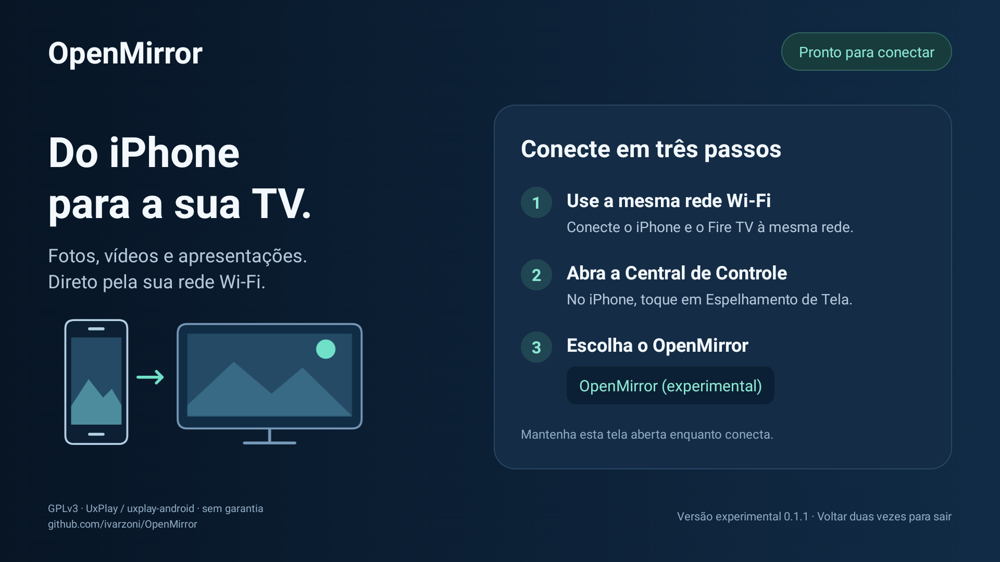

# OpenMirror — Presentation Edition

Receptor AirPlay experimental, gratuito, sem nuvem ou assinatura. Alvo: iPhone →
Fire TV Stick 4K (2ª geração), Fire OS 8.1.8.5 / Android 11.
**Primeiro espelhamento de tela confirmado pelo usuário:** iPhone 15 Pro Max com
iOS 27.2 → Fire TV Stick 4K (2ª geração), Fire OS 8.1.8.5, em 5 de novembro de 2026.
Os logs também confirmaram negociação, recepção H.264 e quadro exibido pelo decodificador.
PowerPoint: espelhamento idêntico ao iPhone confirmado pelo usuário; notas no celular
com slides separados na TV **não funcionaram no teste**. YouTube: áudio na TV confirmado
pelo usuário; não foi determinado se o aplicativo usou espelhamento ou envio direto.
Fotos: modo de apresentação confirmado pelo usuário; vídeos de Fotos com áudio na TV.
PDFs: espelhamento idêntico ao iPhone confirmado, sem comportamento especial de apresentação.
Legibilidade medida, estabilidade prolongada e uso sem internet continuam pendentes.
Esses testes não estabelecem compatibilidade geral com outros aparelhos ou versões.

O iPhone abre Fotos, PowerPoint e PDFs e transmite pixels da tela. O APK não abre
PPTX/PDF. Prioridade: Central de Controle → Espelhamento de Tela. O botão AirPlay
interno de cada aplicativo é um caminho separado e não está validado.

Base real de negociação, criptografia e transporte: UxPlay, através da porta
[gzhanlei/uxplay-android](https://github.com/gzhanlei/uxplay-android), commit
`d9646d76cd416a79c5d800d7f306f1b11c7e4b2d`. Vídeo: JNI → MediaCodec → SurfaceView.
Não é um anúncio mDNS vazio. **Nome visível no iPhone não comprova espelhamento.**

Consulte [viabilidade e licenças](docs/FEASIBILITY.md), [arquitetura](docs/ARCHITECTURE.md),
[testes no aparelho](docs/TESTING.md) e [validação realizada](docs/VALIDATION.md).

## Tela de conexão

A versão 0.1.1 traz instruções em três passos, ilustração vetorial e indicador de
prontidão. A tela de espera é ocultada quando o decodificador apresenta vídeo.



## Compilar no Mac

Instale Android Studio pelo [site oficial](https://developer.android.com/studio),
ou as ferramentas Android de linha de comando. Use JDK **17**, Platform 34,
Build Tools 34.0.0, NDK 26.3.11579264 e CMake 3.22.1. Emulador não é necessário.
O primeiro build baixa ferramentas/dependências; o app usa a rede local.

```bash
export JAVA_HOME="CAMINHO_DO_JDK_17/Contents/Home"
export ANDROID_HOME="$HOME/Library/Android/sdk"
export NDK_HOME="$ANDROID_HOME/ndk/26.3.11579264"
"$ANDROID_HOME/cmdline-tools/latest/bin/sdkmanager" \
  'platform-tools' 'platforms;android-34' 'build-tools;34.0.0' \
  'ndk;26.3.11579264' 'cmake;3.22.1'
bash deps/build_openssl.sh
bash scripts/doctor.sh
./gradlew --no-daemon assembleDebug
```

O gerenciador Android apresenta suas licenças para aceite. Gradle fixado em 8.7,
plugin Android 8.5.2. APK: `app/build/outputs/apk/debug/app-debug.apk`.
Assinatura debug, uso experimental. Release exige configuração de assinatura própria.

## Instalar

No Fire TV: Configurações → Meu Fire TV → Sobre. Se as opções de desenvolvedor
não aparecerem, pressione sete vezes o nome do aparelho. Habilite Depuração ADB,
descubra o IP na seção Rede e autorize a conexão do Mac na TV.

```bash
bash scripts/install.sh 192.168.1.50:5555  # substitua pelo IP real
bash scripts/capture.sh 192.168.1.50:5555 teste.log
# Após encerrar a captura com Ctrl+C:
python3 scripts/analyze_log.py teste.log
```

Mantenha OpenMirror aberto na TV. Mac, TV e iPhone na mesma rede, sem isolamento
entre clientes. No iPhone: Espelhamento de Tela → OpenMirror (experimental).
Voltar duas vezes encerra o receptor. Sem boot automático ou permissão de sobreposição.
Desative a depuração ADB ao terminar. ABI inicial: **armeabi-v7a**, confirmada pelo
script antes da instalação; CPU 64 bits não comprova ABI do sistema operacional.

`dns-sd -B _airplay._tcp local.` no Mac inspeciona descoberta, sem provar vídeo.

## Verificação local

```bash
python3 -m unittest discover -s tests -v
```

Os testes verificam a classificação de evidências; não testam AirPlay. Build concluído
não comprova iOS/Fire OS. Fotos, PDF e PowerPoint exigem inspeção visual na TV.
Áudio é herdado; houve confirmação de som na TV em um teste com YouTube.
Sincronismo, codecs e estabilidade prolongada do áudio ainda não foram validados. Sem promessa de 4K,
60 fps, múltiplos clientes ou conteúdo protegido por DRM.

## Licença

GPL-3.0; veja [créditos e dependências](THIRD_PARTY.md). Não é produto certificado
pela Apple. Este protótipo aceita conexões locais sem PIN: use rede de confiança.
Namespace Java/JNI original preservado; applicationId: `org.openmirror.presentation`.
