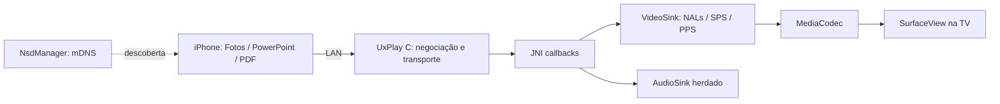

# Arquitetura

AirPlayService inicia o núcleo e registra anúncios. MirrorActivity mantém Surface
e tela ligada. O callback MediaCodec de quadro exibido gera VIDEO_FRAME_RENDERED.
Somente chegada de pacotes não oculta a espera. Um slide parado não deve ser
coberto pela espera depois de três segundos sem mudanças.

CLIENT_CONNECTED representa transporte, VIDEO_PACKET_RECEIVED representa primeiro
callback de vídeo, MDNS_REGISTERED representa registro local, não descoberta no iPhone.
O callback de quadro não comprova conteúdo correto/legibilidade; observar na TV.

Sem GStreamer/Avahi, serviços Google, boot automático ou sobreposição. Código Java/JNI
mantém nomes upstream; applicationId separado evita substituir o APK original.
Sem conversor Office ou upload: documentos são renderizados no iPhone.

Próximos marcos: confirmar ABI/decodificadores; instalar; negociar sessão; confirmar
quadros e conteúdo; testar pausa/reconexão/orientação; depois revisar flags TXT,
PIN, concorrência/encerramento, filas sob perda de pacotes e áudio.
OpenSSL herdado 3.3.2 é antigo, inicialmente fixado para reproduzir a base. Atualizar
dependências e repetir testes é requisito antes de uma versão de distribuição.
